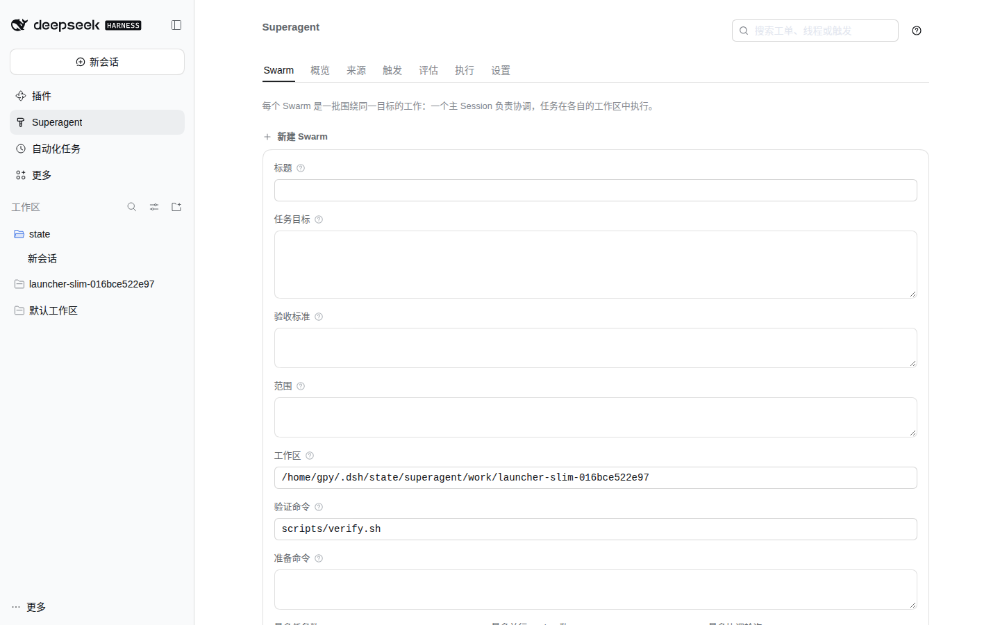
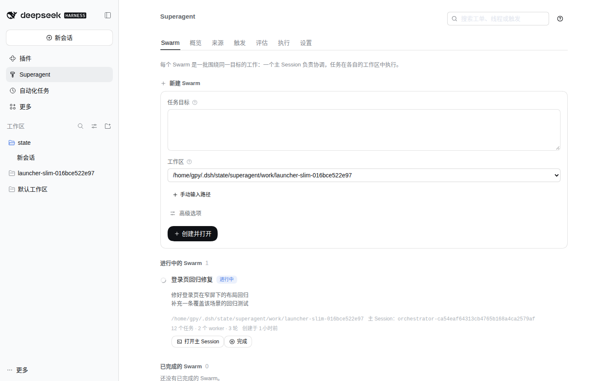
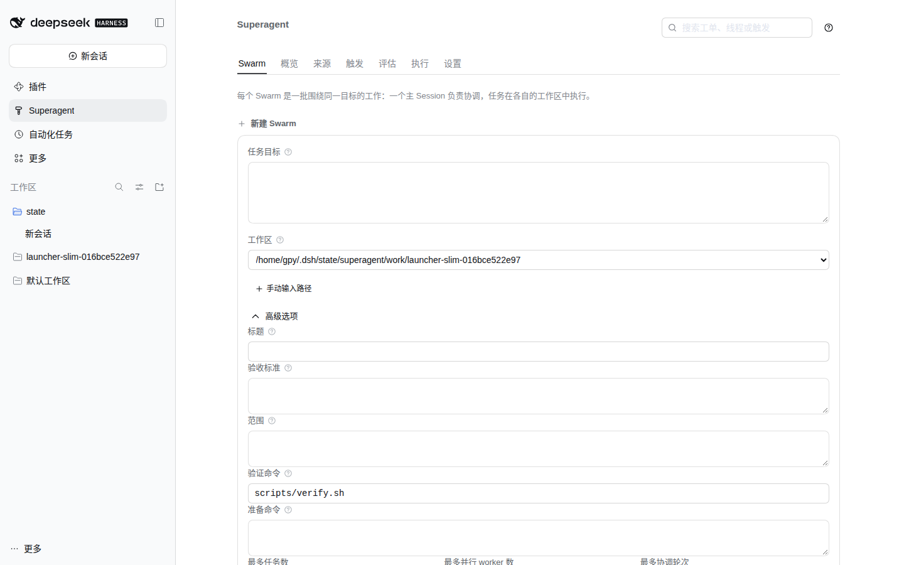
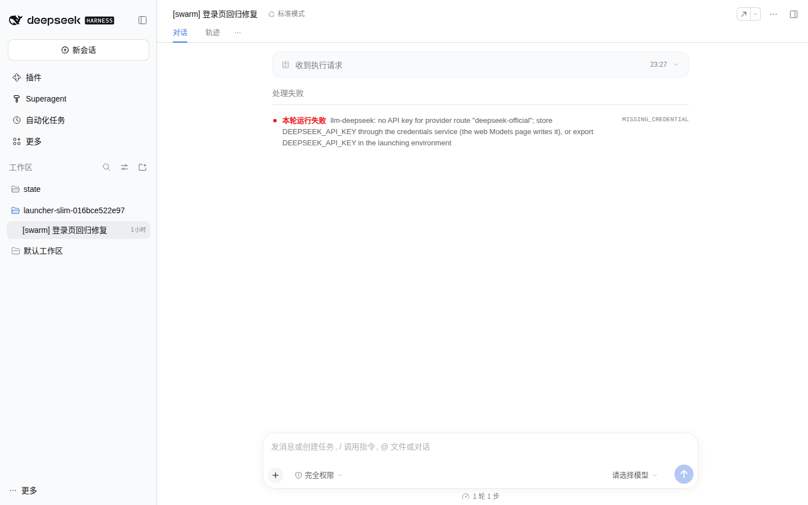
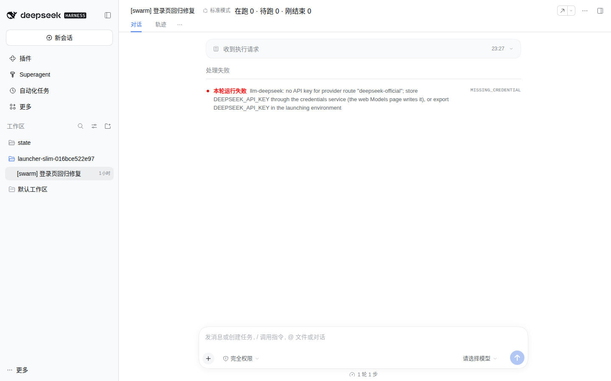

# Launcher slimming evidence (11-06-launcher-slim)

Baseline: `69c016d` (`fix: deliver ticket messages to the Session that dispatched them`), the `main` this ticket's
worktree starts from.
After: this ticket's working tree; the main Session commits it.

Both sets were captured from the actual panel in an isolated DSH Web profile, not from a mockup. The baseline ran from
a tree exported with `git archive HEAD` and built there; this tree ran from the ticket worktree. Each ran against the
same seeded state under `DSH_HOME=/tmp/dsh-launcher-shots`: the Local Source pointed at this worktree, the Policy
allowed its actor, and one active Swarm (`登录页回归修复`) owned its master Session. The baseline served
`http://127.0.0.1:3097` and this tree `http://127.0.0.1:3098`; viewport `1440x900`, default light theme.

| Scenario | Before | After |
| --- | --- | --- |
| Swarm launcher |  |  |
| Advanced options (collapsed by default) | — every field was always shown |  |
| Master Session header |  |  |

The visible changes:

- The launcher asks for only the mission and a workspace. The workspace is a dropdown of the registered long-term
  workspaces with the local repository selected by default; **手动输入路径** switches to a typed path. The title,
  acceptance, scope, validation command, prepare command and budget are folded under **高级选项**, collapsed by
  default.
- The master Session header shows the Swarm's task status: running, waiting and just-ended counts plus the latest
  change. A Session that owns no active Swarm renders nothing; the same absent strip is what the Before header shows.

Both runs show the same `MISSING_CREDENTIAL` turn error because the isolated profile has no model credentials. That
state is identical in both and is unrelated to these changes; it is visible so the comparison states its scenario
honestly.

The status strip is registered into DSH's additive `conversation.session.header.actions` list rather than
`conversation.header`. `conversation.header` is a single-occupancy slot that the conversation shell itself occupies,
so a second registration would shadow and replace the whole header (a hazard DSH documents) instead of adding a
status strip; `conversation.session.header.actions` is the additive header seat DSH's own agent-team status uses.
