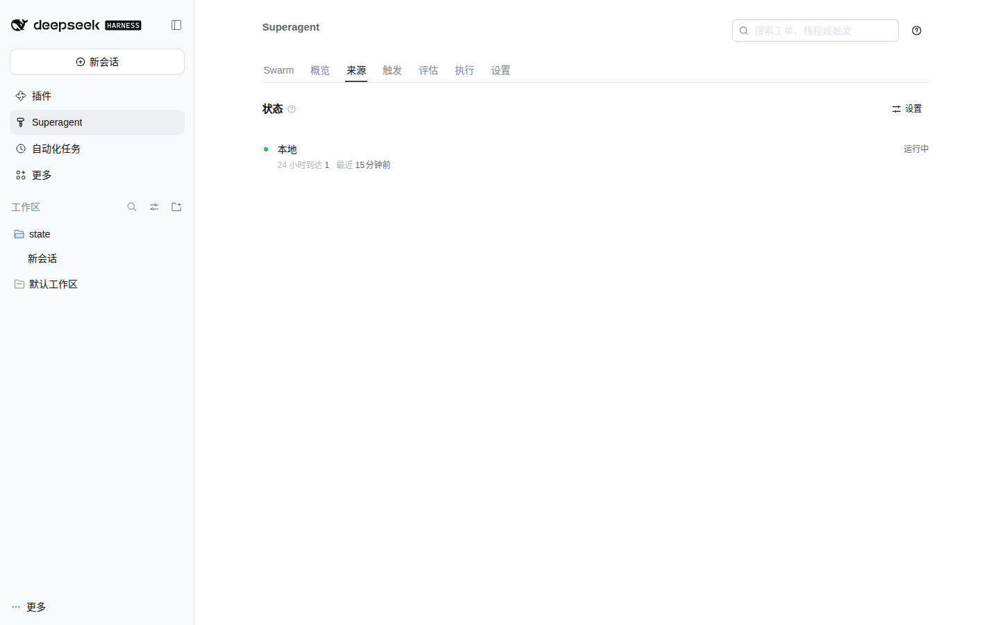
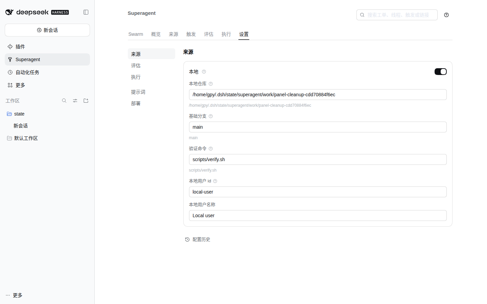
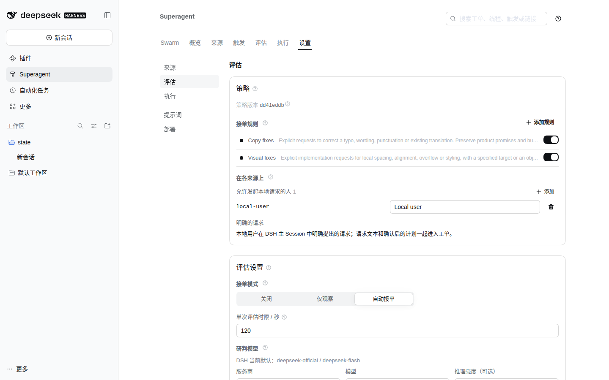
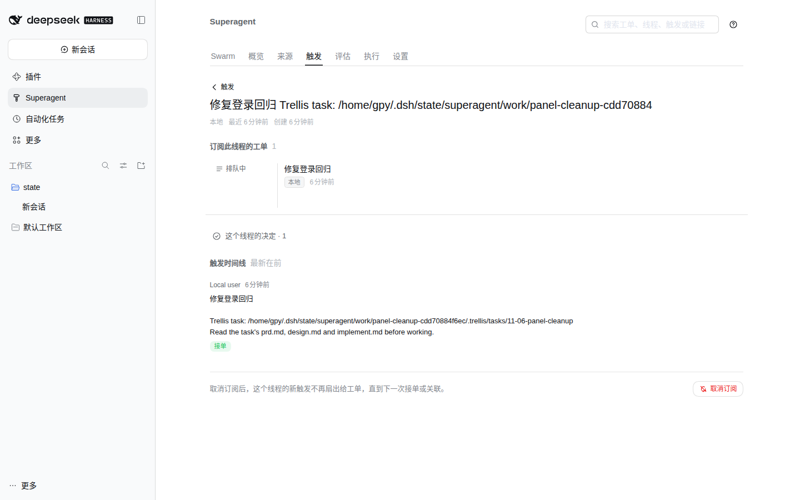
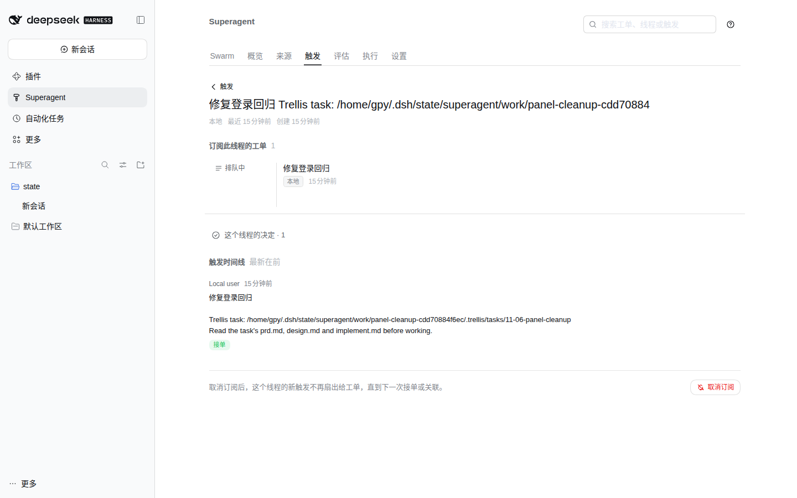
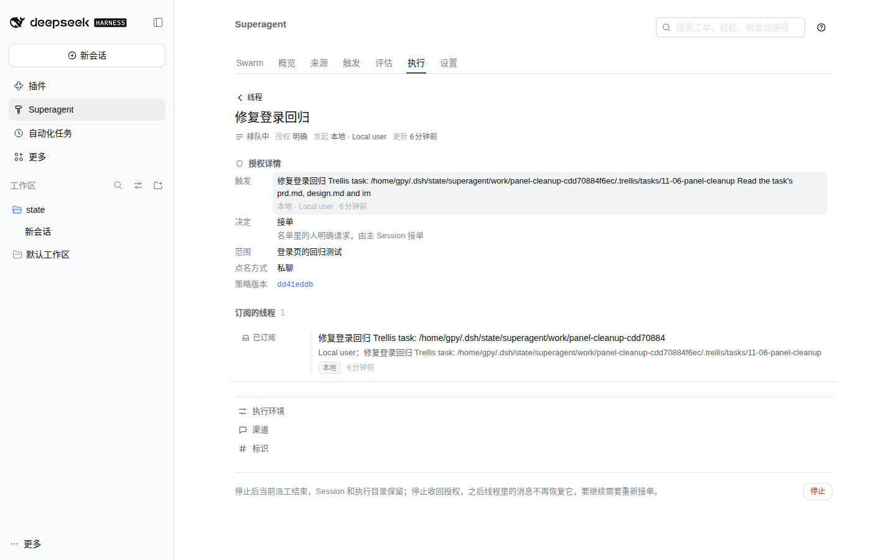
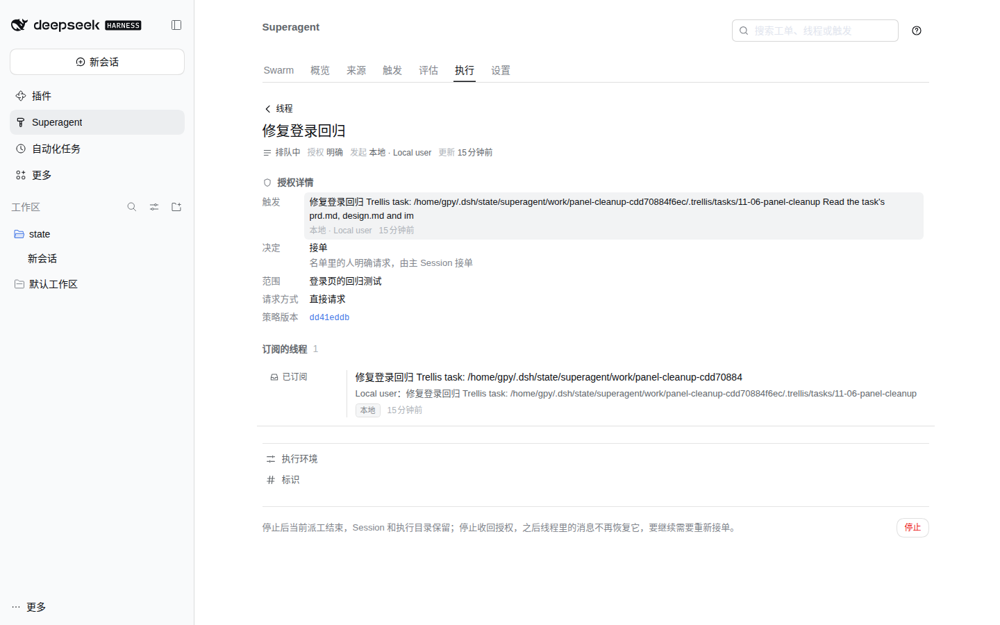

# Panel cleanup evidence (11-06-panel-cleanup)

Baseline: `5d8b327` (`refactor: remove GitHub and Feishu sources`, the `main` this ticket's worktree starts from).
After: this ticket's working tree; the main Session commits it.

Both sets were captured from the actual panel in an isolated DSH Web profile (`DSH_HOME=/tmp/dsh-panel-shots`,
`http://127.0.0.1:3099`), not from a mockup. Each run used the same seeded state: the Local Source pointed at this
worktree, with one local Trigger, its Thread, and one queued Ticket, with processing paused. Viewport `1440x900`,
default light theme.

| Scenario | Before | After |
| --- | --- | --- |
| Source status |  |  |
| Settings › Source |  |  |
| Settings › Eval (Policy on the local Source) |  |  |
| Trigger › Thread |  |  |
| Execution › Ticket |  |  |

The visible changes are copy and links that belonged to the removed remote Sources:

- Search placeholder and the Eval section no longer mention links or multiple Sources; the Policy section is
  **本地来源** (Local Source).
- A Ticket's basis reads **请求方式：直接请求** (Requested as: Direct request), not the removed chat-specific
  **私聊**.
- The local Ticket no longer has a **渠道** (Channel) disclosure with an empty local link. The extra Before image
  expands that disclosure to show the meaningless link: [before/ticket-channels.png](before/ticket-channels.png).
  The After page has no Channel disclosure.
