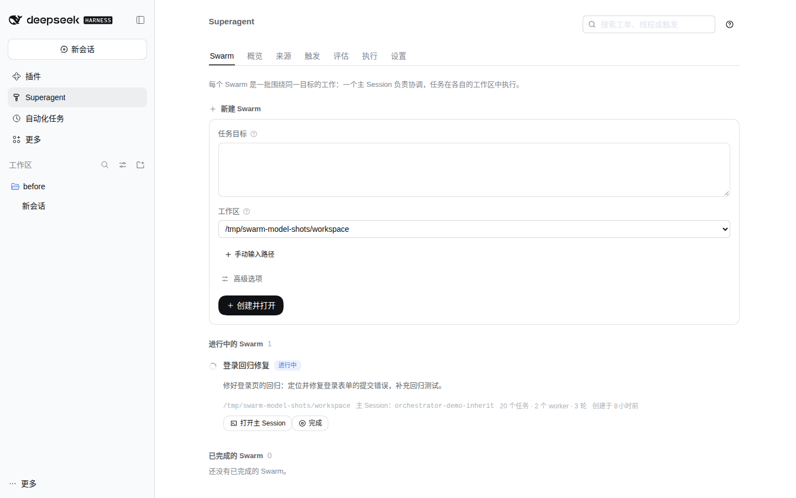
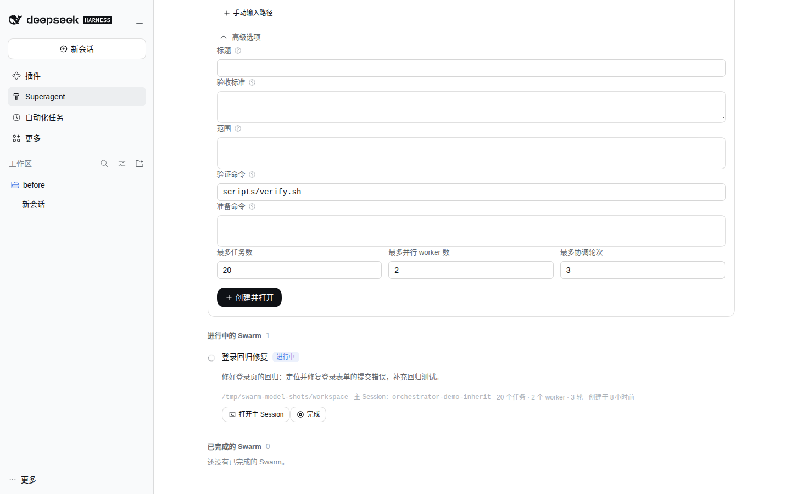
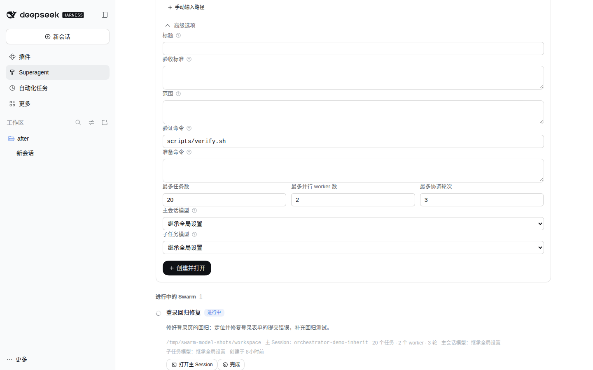
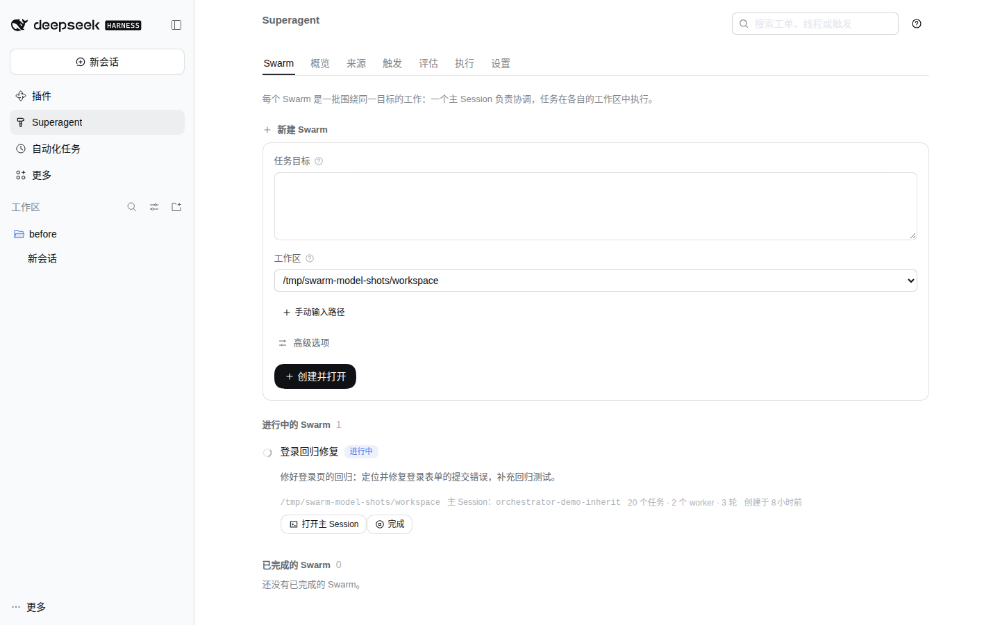
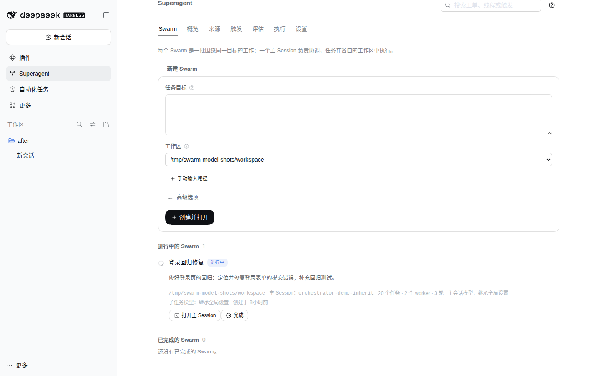
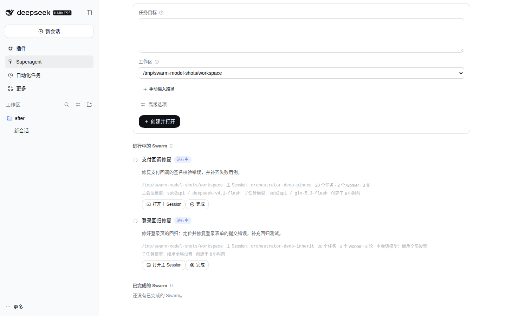

# Swarm model selection evidence (11-06-swarm-models)

Baseline: `8db988d` (`fix: resolve swarm and DSH session ids in either prefix form`), the `main` this ticket's
worktree starts from.
After: this ticket's working tree; the main Session commits it.

Both sets were captured from the actual panel in isolated DSH Web profiles, not from a mockup. The baseline ran from
a tree exported with `git archive HEAD` and built there; this tree ran from the ticket worktree, built by
`scripts/verify.sh`. Each profile had its own `DSH_HOME` under `/tmp/dsh-swarm-model-shots`, its own plugin state
directory, and served `http://127.0.0.1:3095` (before) and `http://127.0.0.1:3096` (after). Viewport `1440x900`,
default light theme, Chinese interface.

Both runs used the same seeded state: the Local Source pointed at `/tmp/swarm-model-shots/workspace` with actor
`local-user` allowed by the Policy, and one active Swarm (`登录回归修复`) without model pins. No model turn ran in
either profile; the isolated profiles carried only a placeholder provider credential so `GET models` lists the
configured models.

| Scenario | Before | After |
| --- | --- | --- |
| Swarm launcher |  |  |
| Advanced options |  |  |
| Active Swarm row |  |  |

The visible changes:

- **高级选项** adds **主会话模型** and **子任务模型**, each a real `<select>` whose first entry is **继承全局设置** and
  whose remaining entries are the providers and models of `GET models` (one `optgroup` per provider). When the catalog
  cannot be read, the two dropdowns keep only the inherit entry and the form says so above them.
- An active Swarm row now names **主会话模型** and **子任务模型**: the pinned `provider / model`, or **继承全局设置**
  when the role is unset.

The two After images below are supplementary; the scenario differs from the pair above and has no Before counterpart.

| Scenario | After |
| --- | --- |
| A worker model chosen in the dropdown (not submitted) |  |
| A second active Swarm seeded with both roles pinned |  |

The pinned row was seeded after the pair capture through the same Store, so the first two rows of the table keep the
identical state on both sides. It shows `主会话模型：sub2api / deepseek-v4.1-flash` and
`子任务模型：sub2api / glm-5.3-flash`; the unpinned Swarm below it still shows **继承全局设置** for both roles.
